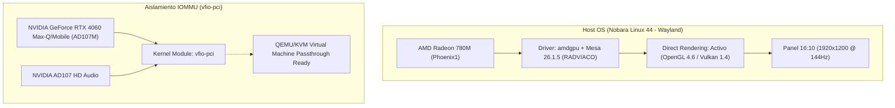

# PROYECTO CLISA — MANIFIESTO 02: INTELIGENCIA Y TELEMETRÍA DE HARDWARE
**Estación de Trabajo:** LENOVO LOQ 16APH8 (ID Placa: `LNVNB161216` // BIOS/UEFI: `LYCN49WW` 04/23/2026)  
**Arquitectura de Silicio:** AMD Zen 4 (Phoenix) + NVIDIA Ada Lovelace  
**Fecha de Auditoría:** Agosto 2026

---

## 1. NÚCLEO COMPUTACIONAL (CPU)
* **Procesador:** **AMD Ryzen 7 7840HS w/ Radeon 780M Graphics**
* **Arquitectura:** x86_64 // Zen 4 (Litografía TSMC 4nm)
* **Topología:** 8 Núcleos Físicos / 16 Hilos (SMT)
* **Frecuencias de Operación:**
  * Base Mínima: `419.42 MHz`
  * Base Nominal / Scaling: `1,330.00 MHz` – `3,801.00 MHz`
  * Boost: Habilitado dinámicamente (`amd_pstate_epp` / `cppc`)
* **Jerarquía de Memoria Caché:**
  * **L1 Data:** 256 KiB (8x 32 KiB, 8-way)
  * **L1 Instruction:** 256 KiB (8x 32 KiB, 8-way)
  * **L2 Cache:** 8 MiB (8x 1 MiB, 8-way)
  * **L3 Cache:** 16 MiB (16-way compartida)
* **Instrucciones Clave para Ingeniería:** AVX-512 (F, DQ, IFMA, CD, BW, VL, BF16, VBMI, VBMI2, VNNI, BITALG, VPOPCNTDQ), AVX2, FMA3, AES-NI, VAES, GFNI, SHA-NI.
* **Virtualización por Hardware:** AMD-V (`svm`) con Nested Page Tables (`npt`) y soporte IOMMU completo.

---

## 2. MEMORIA PRINCIPAL Y ESQUEMA DE INTERCAMBIO (RAM & ZRAM)
* **Capacidad Total Instalada:** 16.0 GiB DDR5 (Direccionamiento visible en SO: `14.8 GiB`, con VRAM compartida para iGPU).
* **Consumo Basal:** ~4.5 GiB en uso (30.6%) // ~6.0 GiB en caché/buffers // ~10.0 GiB disponibles.
* **Mapeo de Swap Comprimido (ZRAM):**
  * Dispositivo: `/dev/zram0`
  * Capacidad: `8.0 GiB`
  * Compresión: `LZ4` / `842`
  * Prioridad: `100`
  * Estado de uso: `0 Bytes` (Margen 100% libre).

---

## 3. MATRIZ GRÁFICA Y CONTROLADORES (GPU DUAL & IOMMU)



### 3.1. iGPU (Render Primario del Sistema)
* **Dispositivo:** AMD Radeon 780M Graphics (`[1002:15bf]` Rev c2).
* **Driver Activo:** `amdgpu` (Mesa 26.1.5 RADV ACO).
* **Capacidades:** Aceleración por hardware completa, Vulkan 1.4.354, OpenGL 4.6 Core/Compatibility.
* **Temperatura Operativa:** ~41.0 °C – 42.0 °C.

### 3.2. dGPU (Aislada en VFIO)
* **Dispositivo:** NVIDIA Corporation AD107M [GeForce RTX 4060 Max-Q / Mobile] (`[10de:28e0]` Rev a1).
* **Driver Activo:** **`vfio-pci`** (Módulos `nouveau` y `nova-core` en lista negra por kernel cmdline).
* **Kernel Flags:** `amd_iommu=on iommu=pt rd.driver.blacklist=nouveau rd.driver.blacklist=nova-core`.
* **Propósito:** Lista para inyección directa en máquinas virtuales KVM para software CAD exclusivo o cómputo CUDA aislado.

---

## 4. TOPOLOGÍA DE ALMACENAMIENTO Y ESQUEMA BTRFS

```text
========================================================================================
DISCO 1 (LINUX HOST): Samsung MZAL41T0HBLB-00BL2 (953.9 GiB NVMe PCIe Gen4) [Temp: 38.9°C]
========================================================================================
├── nvme0n1p1   1.0 GiB    vfat (FAT32)   /boot/efi        (Uso: 53 MB / 5%)
├── nvme0n1p2   2.0 GiB    ext4           /boot            (Uso: 686 MB / 38%)
├── nvme0n1p3   348.0 GiB  btrfs (subvol=@) /              (Uso: 15 GB / 5%, compress=zstd:1)
├── nvme0n1p4   569.9 GiB  btrfs          /home            (Uso: 23 GB / 4%, compress=zstd:1, Label: DATA_Nobara)
└── nvme0n1p5   33.0 GiB   ntfs           [Sin montar]     (Partición de reserva)

========================================================================================
DISCO 2 (WINDOWS DUAL-BOOT - PROTEGIDO): A-DATA LEGEND 900 PRO (1.86 TiB NVMe PCIe Gen4) [Temp: 27.9°C]
========================================================================================
├── nvme1n1p1   16.0 MiB   --             [MSR Reservada]
├── nvme1n1p2   953.1 GiB  ntfs           Windows OS       (Label: Windows)
├── nvme1n1p3   769.0 MiB  ntfs           WinRE Recovery
├── nvme1n1p4   953.3 GiB  ntfs           Data Windows     (Label: Data Windows)
└── nvme1n1p5   525.0 MiB  vfat (FAT32)   SYSTEM ESP       (Label: SYSTEM)
```

---

## 5. SENSORES Y SALUD TÉRMICA / BATERÍA
* **Batería:** Lenovo BYD `L22B4PA0` // Capacidad Actual: `50.5 Wh` sobre `60.0 Wh` de diseño (**84.2% de salud**).
* **Temperaturas Basales:**
  * CPU: `42.0 °C – 44.0 °C`
  * iGPU: `42.0 °C`
  * SSD Samsung (Host): `38.9 °C – 42.9 °C`
  * SSD A-Data (Dual-boot): `27.9 °C – 28.9 °C`
