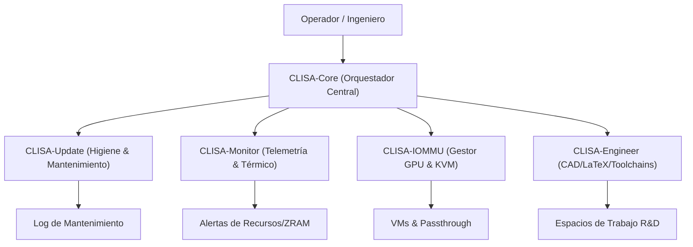

# PROYECTO CLISA — MANIFIESTO 04: ORQUESTACIÓN Y PROTOCOLOS DE AGENTES
**Plataforma de Ejecución:** Antigravity CLI (Nivel 4 Orchestrator)  
**Esquema de Agentes:** Especialización Modular & Gobernanza Centralizada

---

## 1. MATRIZ DE ROLES DE AGENTES (CLISA AGENT ROSTER)

Para mantener la regla **90/5/5** y garantizar la estabilidad del sistema, se definen los siguientes perfiles de subagentes especializados:

### 1.1. `CLISA-Core` (Orquestador y Guardián Arquitectónico)
* **Objetivo:** Mantener el estado de la sesión, resolver dependencias entre agentes y asegurar que ninguna directiva inmutable sea violada.
* **Frecuencia:** Residente durante todas las invocaciones en Antigravity CLI.

### 1.2. `CLISA-Update` (Mantenimiento Proactivo Zero-Touch)
* **Objetivo:** Ejecutar la actualización silenciosa de Flatpak, limpieza de cachés temporales, verificación de huérfanos y auditoría de actualizaciones DNF pendientes.
* **Restricción:** No reiniciar servicios críticos en caliente si hay cargas de cómputo activas.

### 1.3. `CLISA-Monitor` (Telemetría Térmica y de Recursos)
* **Objetivo:** Monitorear temperaturas de la CPU Zen 4 y GPUs, desgaste de la batería Lenovo (umbral actual: 84.2%), presión sobre ZRAM y balance de subvolúmenes Btrfs.

### 1.4. `CLISA-IOMMU` (Controlador de Aislamiento Gráfico)
* **Objetivo:** Administrar el estado de la GPU NVIDIA RTX 4060 Mobile.
* **Comportamiento:**
  * Modo 1 (Default): Enlazada a `vfio-pci` para aprovisionamiento de VMs QEMU/KVM de simulación.
  * Modo 2 (Cómputo Local): Reasignación a drivers propietarios `nvidia` para renderizado CUDA/OptiX en el host cuando sea requerido explícitamente.

### 1.5. `CLISA-Engineer` (Automatización de Flujos R&D)
* **Objetivo:** Aprovisionamiento de plantillas LaTeX para informes técnicos, compilación automatizada de esquemáticos con `circuitikz`, exportación por lotes de modelos FreeCAD/OpenSCAD y flashes de firmware vía `arduino-cli`.

---

## 2. PROTOCOLO DE COMUNICACIÓN Y REPORTES (TELEMETRY CONTRACT)

1. **Respuestas Sintéticas y Estructuradas:** Los agentes deben procesar la información en segundo plano y comunicarse con el Operador mediante tablas, diagramas Mermaid y alertas markdown estructuradas.
2. **Cero Fricción (Non-blocking):** Las operaciones de fondo (descargas de paquetes, compilaciones masivas) deben ejecutarse como tareas asíncronas de fondo.
3. **Reportes de Estado:** Cada agente debe registrar sus acciones en el log de auditoría del proyecto local sin ensuciar la salida estándar del usuario.
