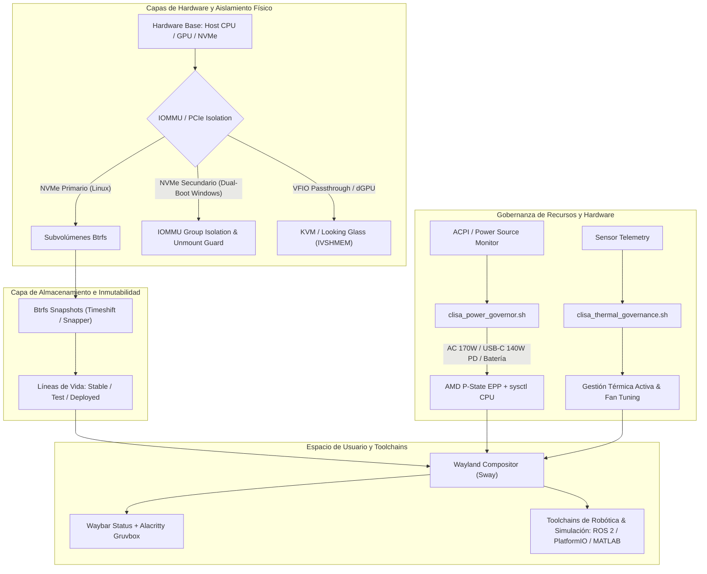

<div align="center">

# ⚡ CLISA: Core Linux Intelligent System Architecture
### Deterministic Workstation Deployment, Thermal/Power Governance & Virtualization Isolation Suite

[](LICENSE)
[](docs/00_STATE_OF_THE_ART.md)
[](config/sway/config)
[](config/timeshift.json)
[](IOMMU_GROUP_AUDIT.md)
[](CITATION.cff)

**Despliegue determinista e infraestructura como código para workstations de ingeniería electromecánica, simulación multifísica y desarrollo robótico.**

</div>

---

## 💡 Elevator Pitch: ¿Qué Resuelve CLISA?

En entornos de **ingeniería electromecánica, simulación multifísica (MATLAB, Simulink, ANSYS) y robótica autónoma (ROS 2, Gazebo, DanyBot/CMU)**, las estaciones de trabajo modernas enfrentan cuatro desafíos críticos:

1. **Inestabilidad y regresiones del SO:** Actualizaciones de kernel o paquetes que rompen toolchains científicos y drivers propietarios de GPU.
2. **Agotamiento térmico y throttling acústico:** CPUs multi-núcleo de alta densidad térmica (e.g., AMD Zen 4) que alcanzan picos de 95°C bajo compilación masiva o simulación FEM si no existe modulación fina de EPP (*Energy Performance Preference*) y curvas de ventilación.
3. **Contención de periféricos y dual-boot:** Riesgo de corrupción accidental del disco secundario (e.g., particiones Windows en dual-boot) y fricción al capturar analizadores lógicos o programadores embebidos sin privilegios `root`.
4. **Dependencia de configuración manual:** Falta de reproducibilidad e idempotencia al aprovisionar estaciones idénticas en laboratorios o bancos HIL (*Hardware-in-the-Loop*).

**CLISA (*Core Linux Intelligent System Architecture*)** aborda estos problemas mediante una suite declarativa y modular de scripts bash idempotentes, políticas de kernel `sysctl`/`udev`, gobernanza de energía por hardware y virtualización aislada con KVM/IOMMU.

---

## 🏛️ Arquitectura del Sistema

El siguiente diagrama detalla el flujo de aislamiento, gobernanza y capas de ejecución de CLISA:



---

## 💻 Matriz de Compatibilidad de Hardware y Perfiles

CLISA fue desarrollado y validado sobre arquitectura móvil de alto rendimiento **AMD Zen 4 + NVIDIA RTX 4000**, pero su diseño desacoplado permite desplegarlo y parametrizarlo en cualquier estación de trabajo moderna.

| Subsistema | Configuración de Referencia (LOQ 16APH8) | Driver / Módulo Linux | Parametrización para Otras Workstations |
| :--- | :--- | :--- | :--- |
| **Procesador** | AMD Ryzen 7 7840HS (8C/16T, Zen 4) | `amd_pstate=active` | Ajustar escalamiento EPP en [`config/99-clisa-cpu.conf`](config/99-clisa-cpu.conf). En Intel, configurar `intel_pstate`. |
| **Gráficos Integrados** | AMD Radeon 780M (RDNA 3) | `amdgpu` (Wayland primary) | Controlador primario para display Sway y bajo consumo. |
| **Gráficos Dedicados** | NVIDIA GeForce RTX 4060 Max-P (8GB) | `nvidia` / `vfio-pci` | Modo híbrido vía `prime-run` o passthrough directo IOMMU a VM de simulación. |
| **Almacenamiento** | NVMe PCIe 4.0 Dual (Linux / Windows) | `btrfs` / `nvme` | Identificar `/dev/nvmeXn1` en [`config/clisa_aliases.sh`](config/clisa_aliases.sh) para `clisa-nvme-check`. |
| **Gestión Térmica** | Lenovo Vantage WMI / EC Sensors | `ideapad_laptop` / `hwmon` | Adaptar nodos de sensores en [`scripts/clisa_thermal_governance.sh`](scripts/clisa_thermal_governance.sh). |
| **Alimentación** | AC 170W / USB-C 140W PD / Batería | `upower` / `sysfs` power_supply | Umbrales y fuentes configurables en [`scripts/clisa_power_governor.sh`](scripts/clisa_power_governor.sh). |
| **Instrumentación HIL** | Logic Analyzers (Saleae, FX2), ST-Link, ESP32 | `udev` (libsigrok / platformio) | Reglas preinstaladas en [`config/60-libsigrok.rules`](config/60-libsigrok.rules) y [`config/99-platformio-udev.rules`](config/99-platformio-udev.rules). |

---

## 📂 Mapa del Repositorio y Componentes

Todos los enlaces en esta tabla apuntan a archivos verificados dentro del árbol del repositorio:

### 📚 Documentación Técnica y Gobernanza
* [**`docs/00_STATE_OF_THE_ART.md`**](docs/00_STATE_OF_THE_ART.md): Génesis del proyecto, justificación de arquitectura (Nobara, Btrfs, Wayland, Sway, ACPI/PD).
* [**`docs/01_SYSTEM_ARCHITECTURE.md`**](docs/01_SYSTEM_ARCHITECTURE.md): Topología integral del sistema, diagramas de flujo Mermaid y contratos de aislamiento.
* [**`docs/02_DEV_BACKLOG.md`**](docs/02_DEV_BACKLOG.md): Hoja de ruta priorizada, backlog de desarrollo y mitigación de deuda técnica.
* [**`docs/03_AGENT_SWARM_PROTOCOLS.md`**](docs/03_AGENT_SWARM_PROTOCOLS.md): Protocolos del enjambre de agentes autónomos, bucle O-I-P-E-V-R y consenso tripartito.
* [**`01_Goal_Objective.md`**](01_Goal_Objective.md): Visión fundacional, directivas de confiabilidad y regla cognitiva 90/5/5.
* [**`02_Hardware_Intelligence.md`**](02_Hardware_Intelligence.md): Inventario de hardware, mapeo de sensores y estructura de particiones.
* [**`03_Software_Intelligence.md`**](03_Software_Intelligence.md): Inventario de software, toolchains electromecánicos y Gap Analysis.
* [**`04_Agent_Orchestration.md`**](04_Agent_Orchestration.md): Esquema de agentes residentes y telemetría de auditoría.
* [**`COMMAND_EXECUTION_AUDIT.md`**](COMMAND_EXECUTION_AUDIT.md): Bitácora histórica de comandos ejecutados en el aprovisionamiento.
* [**`IOMMU_GROUP_AUDIT.md`**](IOMMU_GROUP_AUDIT.md): Topología de grupos IOMMU, PCIe bridges y aislamiento de GPU/NVMe.
* [**`GIT_GOVERNANCE_AUDIT.md`**](GIT_GOVERNANCE_AUDIT.md): Bitácora de gobernanza de ramas, firmas y sincronización.

### ⚙️ Arsenal de Scripts Operativos (`scripts/`)
| Script | Propósito y Operación |
| :--- | :--- |
| [`scripts/clisa_sys_foundation.sh`](scripts/clisa_sys_foundation.sh) | Cimentación del sistema base, afinación de `sysctl`, actualización de paquetes y reglas udev. |
| [`scripts/clisa_phase6_shield.sh`](scripts/clisa_phase6_shield.sh) | Blindaje Btrfs, políticas de snapshots Timeshift/Snapper y herramientas electromecánicas. |
| [`scripts/clisa_thermal_governance.sh`](scripts/clisa_thermal_governance.sh) | Gobernanza térmica para CPU/GPU, supresión de thermal throttling y telemetría en tiempo real. |
| [`scripts/clisa_power_governor.sh`](scripts/clisa_power_governor.sh) | Selector dinámico de perfil de energía (AC High Power vs USB-C 140W PD vs Batería). |
| [`scripts/clisa_matlab_silent_deploy.sh`](scripts/clisa_matlab_silent_deploy.sh) | Instalador desatendido y smoke test automatizado para MATLAB y toolboxes científicos. |
| [`scripts/clisa_draconian_sync.sh`](scripts/clisa_draconian_sync.sh) | Purga determinista de cachés, sincronización DNF y reparación de runtimes Flatpak. |

### 🔧 Archivos de Configuración del Sistema (`config/`)
| Archivo de Configuración | Función |
| :--- | :--- |
| [`config/99-clisa-cpu.conf`](config/99-clisa-cpu.conf) | Parámetros de gobernador y EPP para CPU (*AMD P-State*). |
| [`config/99-clisa-mem.conf`](config/99-clisa-mem.conf) | Afinado de memoria virtual, compresión ZRAM y presión sobre caché VFS. |
| [`config/99-clisa-network.conf`](config/99-clisa-network.conf) | Fortalecimiento TCP/IP (algoritmo BBR, mitigación SYN flood, TCP Fast Open). |
| [`config/60-libsigrok.rules`](config/60-libsigrok.rules) | Reglas udev sin privilegios para analizadores lógicos e instrumentación de laboratorio. |
| [`config/99-platformio-udev.rules`](config/99-platformio-udev.rules) | Reglas udev para desarrollo embebido (FTDI, CH34x, STM32, Raspberry Pi Pico, Teensy). |
| [`config/10-looking-glass.conf`](config/10-looking-glass.conf) | Regla de memoria compartida IVSHMEM para ultra-baja latencia en máquinas virtuales KVM. |
| [`config/timeshift.json`](config/timeshift.json) | Política de snapshots Btrfs para rollback determinista pre-boot. |
| [`config/clisa_aliases.sh`](config/clisa_aliases.sh) | Aceleradores de terminal, atajos de shell y comandos `clisa-status` / `clisa-power`. |
| [`config/sway/config`](config/sway/config) | Configuración del gestor de ventanas tiling Sway sobre Wayland. |
| [`config/waybar/config`](config/waybar/config) | Barra de estado Waybar con telemetría de CPU, RAM, térmica y batería. |
| [`config/alacritty/alacritty.toml`](config/alacritty/alacritty.toml) | Emulador de terminal acelerado por GPU con paleta Gruvbox de alto contraste. |
| [`config/mako/config`](config/mako/config) | Servidor de notificaciones ligeras para Wayland. |
| [`config/modprobe.d/lenovo-audio.conf`](config/modprobe.d/lenovo-audio.conf) | Ajustes modprobe para codecs de audio HD y supresión de chasquidos de energía. |
| [`config/sddm.conf.d/autologin.conf`](config/sddm.conf.d/autologin.conf) | Configuración de inicio de sesión gráfico SDDM. |

---

## ⚡ Quick Start Reproducible

El despliegue de CLISA está diseñado para ser idempotente y no destructivo, utilizando variables de entorno parametrizables sin rutas fijas o nombres de usuario hardcodeados:

```bash
# 1. Definir la raíz de instalación de CLISA (por defecto /opt/clisa o en tu workspace local)
export CLISA_ROOT="${CLISA_ROOT:-/opt/clisa}"

# 2. Clonar el repositorio
git clone https://github.com/alonsoalvaradohr/CLISA_Deployment.git "${CLISA_ROOT}"
cd "${CLISA_ROOT}"

# 3. Cargar los aceleradores de terminal y comandos de telemetría en la sesión de $USER
source "${CLISA_ROOT}/config/clisa_aliases.sh"

# 4. Inspeccionar la salud de la estación de trabajo y sensores
clisa-status

# 5. Verificar que el disco secundario (dual-boot) esté desmontado y aislado
clisa-nvme-check

# 6. Activar la política de energía y gobernanza térmica de acuerdo a la fuente
clisa-power
```

### Líneas de Vida de Despliegue (Lifelines)

| Línea de Vida | Rama / Tag | Propósito | Criterio de Estabilidad |
| :--- | :--- | :--- | :--- |
| **Stable** | `main` | Entorno de producción verificado y operativo. | Tests de hardware y scripts validados al 100%. |
| **Test** | `develop` | Integración continua y candidatos a release. | Validación de nuevas configuraciones y perfiles. |
| **Deployed** | `vX.Y.Z` | Instantáneas inmutables de producción para rollback exacto. | Firmado y documentado en bitácora de gobernanza. |

---

## 🗺️ Roadmap & Help Wanted

El proyecto CLISA agradece contribuciones de la comunidad de código abierto para extender la compatibilidad a una mayor diversidad de hardware de laboratorio y desarrollo:

- [ ] **Perfiles de GPU adicionales:**
  - Soporte y scripts de conmutación para GPUs discretas AMD Radeon (RDNA 2 / RDNA 3) e Intel Arc.
- [ ] **Módulos de entorno de escritorio:**
  - Compatibilidad e integraciones de barra de estado para gestores Wayland alternativos (e.g., Hyprland).
- [ ] **Integración Continua (CI):**
  - Workflow de GitHub Actions con `shellcheck` determinista y validadores de sintaxis para archivos `.conf` y `.rules`.
- [ ] **Orquestación de Contenedores HIL:**
  - Recetas Docker y Singularity con paso directo de dispositivos USB/IOMMU para simulaciones en bucle cerrado.

Para colaborar, consulta nuestras [Pautas de Contribución](CONTRIBUTING.md) y el [Código de Conducta](CODE_OF_CONDUCT.md).

---

## 📄 Licencia y Citación

Este proyecto se distribuye bajo la licencia **Apache 2.0**. Consulta el archivo [LICENSE](LICENSE) para más detalles.

Si utilizas CLISA como base para la infraestructura de laboratorio de tu investigación, tesis o publicación científica, por favor cita el proyecto utilizando los metadatos de [CITATION.cff](CITATION.cff):

```bibtex
@software{Alvarado_CLISA_Deployment_2026,
  author       = {Alvarado, Alonso},
  title        = {{CLISA: Core Linux Intelligent System Architecture - Workstation Deployment Suite}},
  year         = {2026},
  url          = {https://github.com/alonsoalvaradohr/CLISA_Deployment},
  license      = {Apache-2.0}
}
```
