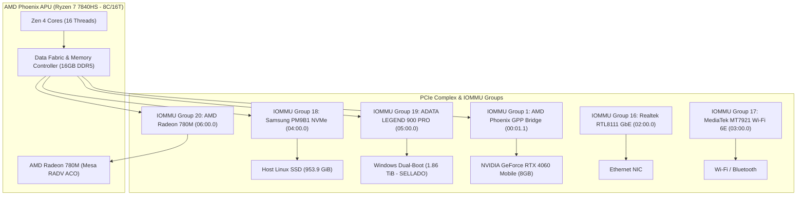
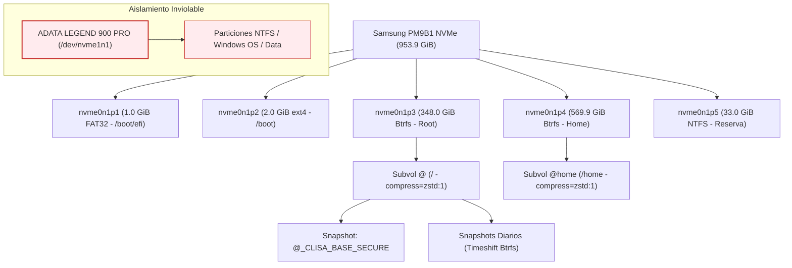
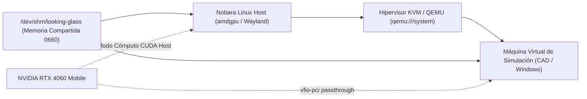
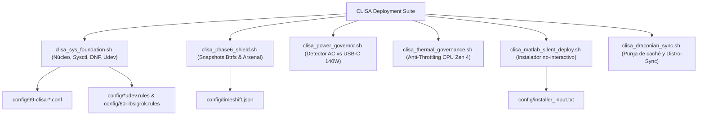
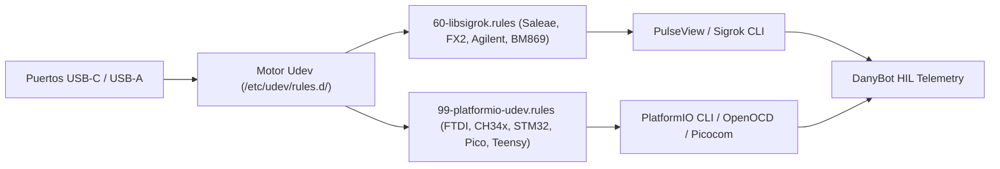

# ARQUITECTURA DE SISTEMA Y TOPOLOGÍA INTEGRAL (CLISA FASE 20)
**Documento:** `docs/01_SYSTEM_ARCHITECTURE.md`  
**Autor:** Agente Arquitecto & CLISA-Core  
**Entorno:** Nobara Linux 44 // AMD Ryzen 7 7840HS // NVIDIA RTX 4060 Mobile

---

## 1. TOPOLOGÍA DE HARDWARE E IOMMU

La siguiente estructura describe la distribución del hardware físico, buses PCIe y grupos de aislamiento IOMMU en la estación de trabajo Lenovo LOQ 16:

---

## 2. ARQUITECTURA DE ALMACENAMIENTO Y SUBVOLÚMENES BTRFS

El disco principal del host implementa subvolúmenes Btrfs con compresión Zstandard en tiempo real y políticas de snapshotting mediante Timeshift y Snapper:

---

## 3. VIRTUALIZACIÓN KVM, IVSHMEM Y GPU PASSTHROUGH

Para cargas de simulación que requieren Windows aislado o aceleración gráfica directa:

---

## 4. ORQUESTACIÓN DE SCRIPTS Y DEPENDENCIAS DE EJECUCIÓN

Los scripts en `scripts/` están organizados de forma modular e idempotente:

---

## 5. CAPA DE INSTRUMENTACIÓN Y HARDWARE-IN-THE-LOOP (HIL)

La estación cuenta con soporte nativo sin root para adquisición de señales y programación de microcontroladores:

---

## 6. ENTORNO TILING Y ERGONOMÍA VISUAL (SWAY / WAYBAR)

El entorno gráfico está diseñado para una latencia cognitiva cero mediante Sway sobre Wayland:

| Workspace | Identificador | Asignación de Aplicaciones | Atajo de Lanzamiento |
| :--- | :--- | :--- | :--- |
| **1** | `1: DEV` | VS Code, Alacritty, Antigravity CLI | `Mod+F1` (`code`), `Mod+Return` (`alacritty`) |
| **2** | `2: CAD` | FreeCAD, Autodesk Fusion 360 | `Mod+F2` (`freecad`), `Mod+F3` (`fusion`) |
| **3** | `3: MANUF` | Creality Print, Slicers 3D | `Mod+F4` (`creality-print`) |
| **4** | `4: DOC` | TeXstudio, LaTeX Wrappers, Jupyter | `Mod+F5` (`texstudio`), `Mod+F6` (`jupyter`) |
| **5** | `5: SYS` | PulseView, MATLAB, Telemetría | `Mod+F7` (`pulseview`), `Mod+F9` (`matlab`) |
