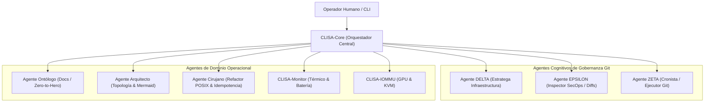

# PROTOCOLOS DEL ENJAMBRE DE AGENTES AUTÓNOMOS (CLISA FASE 20)
**Documento:** `docs/03_AGENT_SWARM_PROTOCOLS.md`  
**Autor:** CLISA-Core (Nivel 10 - Orquestación Desatendida)  
**Marco Metodológico:** SMART Cognitive Architecture & Tripartite Consensus

---

## 1. TAXONOMÍA DEL ENJAMBRE DE AGENTES (AGENT ROSTER)



---

## 2. DESCRIPCIÓN DE PERFILES Y CAPACIDADES

| Agente | Nivel de Permisos | Función Primaria | Criterio de Éxito |
| :--- | :--- | :--- | :--- |
| **CLISA-Core** | Nivel 10 (Global) | Orquestación general, resolución de dependencias y balanceo de carga. | Mantiene la regla 90/5/5 y reduce la entropía a cero. |
| **DELTA** | Lectura / Análisis | Define `.gitignore`, estrategia de ramas y tags semánticos. | Cero ambigüedad en la topología de control de versiones. |
| **EPSILON** | Veto Absoluto | Inspección de diffs, detección de secretos, credenciales o binarios no deseados. | 100% de sanidad pre-push; cero fugas de datos. |
| **ZETA** | Escritura Git | Ejecución de commits atómicos, ramas y sincronización GitHub. | Repositorio remoto sincronizado con código de salida 0. |
| **Ontólogo** | Documentación | Redacción de manifiestos, trazabilidad y compendios explicativos. | Documentación viva "Zero to Hero" accesible para nuevos ingenieros. |
| **Arquitecto** | Visualización | Diagramación de topologías de hardware, virtualización y scripts en Mermaid. | Diagramas legibles, sintácticamente válidos y precisos. |
| **Cirujano** | Refactorización | Limpieza de scripts, estandarización POSIX, `set -euo pipefail`. | Scripts idempotentes y libres de variables huérfanas o rutas absolutas rotas. |
| **CLISA-Monitor** | Telemetría | Supervisión de temperaturas Zen 4, perfiles ACPI y estado de batería. | Prevención proactiva de estrangulamiento térmico (*throttling*). |
| **CLISA-IOMMU** | Aislamiento | Control de asignación de la GPU NVIDIA entre host y máquinas virtuales KVM. | Passthrough determinista sin conflictos de bus PCI. |

---

## 3. BUCLE COGNITIVO O-I-P-E-V-R

Todo agente autónomo en el ecosistema CLISA opera bajo el ciclo ininterrumpido:

```text
[1. OBSERVAR] ---> [2. INVESTIGAR] ---> [3. PLANIFICAR]
       ^                                      |
       |                                      v
 [6. REGISTRAR] <--- [5. VALIDAR] <--- [4. EJECUTAR]
```

1. **Observar (Observe):** Captura del estado actual (`git status`, `sensors`, `lsblk`, etc.).
2. **Investigar (Investigate):** Análisis de causas raíz ante errores, conflictos o anomalías.
3. **Planificar (Plan):** Definición de la acción atómica de menor riesgo y mayor impacto.
4. **Ejecutar (Execute):** Aplicación determinista mediante herramientas CLI nativas.
5. **Validar (Validate):** Verificación de condiciones de salida (código 0, ausencia de secretos, working tree clean).
6. **Registrar (Record):** Actualización inmediata en `COMMAND_EXECUTION_AUDIT.md` y `GIT_GOVERNANCE_AUDIT.md`.

---

## 4. PROTOCOLO DE CONSENSO Y AUTONOMÍA DESATENDIDA
- Queda **estrictamente prohibido** detener la ejecución para solicitar confirmaciones interactivas (`y/n`).
- Ante discrepancias entre agentes, el agente **EPSILON** tiene poder de veto sobre seguridad y secretos, mientras que **CLISA-Core** arbitra decisiones de arquitectura global.
